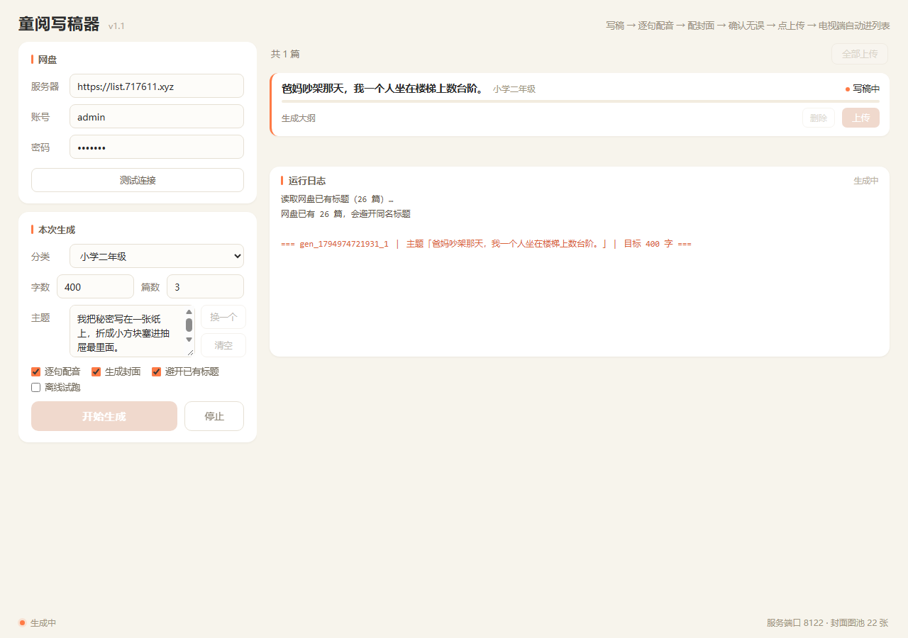

<div align="center">

# 童阅写稿器 KidsWriter

给 [KidsReader](https://github.com/jankxia/KidsReader) 电视端批量写文章的小工具：**一篇文字 + 一张封面 + 逐句音频**，生成完你确认，再一键传进网盘；电视端打开 App 自动扫描进对应年级列表，电视上什么都不用做。

</div>



## 它做什么

- **写稿**：AI 先出 4–6 段大纲，再逐段写，字数不够自动补写；分段失败会退回整篇重写。
- **切句**：按句末标点切句，纯标点句直接丢弃（这种句子合成不出音频，正是以前文章总比音频多一句的原因）。
- **配音**：edge-tts 逐句合成 `001.mp3…`，音色、语速、并发都可配。
- **配封面**：按标题关键词从 `covers/` 的图池里挑，命中不了才按 id 哈希兜底。
- **手动上传**：生成完停在「待上传」，你确认标题、字数、句数、封面无误后再点上传；顺序是建目录 → mp3 → cover → **最后**写 json，电视端不会扫到半成品。

生成过程中卡片和日志都实时显示阶段：

```
[写稿中] 大纲《旧书里的秘密画》共 5 段
[写稿中] 第 2/5 段 80 字，累计 166 字
[配音中] 10/20 句
[上传中] mp3 3/10
```

## 两种跑法

**本机**：双击 `启动.bat`，浏览器打开 `http://127.0.0.1:8122`。

**Docker**（推荐挂 NAS 上，关机自启一直在）：

```yaml
# compose.yaml
services:
  kidswriter:
    build: .
    image: kidswriter:1.1
    container_name: kidswriter
    restart: unless-stopped
    network_mode: host          # 若 NAS 的 docker 网段用尽，用 host 模式最省事
    volumes:
      - /vol1/1000/kidswriter/data:/app/data
    environment:
      TZ: Asia/Shanghai
      KIDSWRITER_PORT: "8122"
```

```bash
docker compose up -d --build
# 或直接用发布好的镜像
docker run -d --name kidswriter --restart unless-stopped \
  --network host -v /你的目录/data:/app/data \
  ghcr.io/jankxia/KidsWriter:latest
```

数据都在 `data/`：`config.json` 和 `输出/<文章id>/`。容器重启后没上传的稿子会自动回到「待上传」，不会丢。

## 配置

首次启动会生成 `config.json`（可照 `config.example.json` 填）：网盘地址与账号、AI 接口与 Key、音色语速、并发数、默认年级与字数。

`config.json` 里有密码和 Key，**不要提交到仓库**（已在 `.gitignore` 里）。

## 目录

```
童阅写稿器/
├─ 启动.bat            本机一键启动
├─ 童阅写稿器.py       写稿 + 配音 + 上传 + 本地服务（仅标准库 + edge-tts）
├─ 界面.html           单页界面
├─ covers/             封面图池，丢新 .jpg 进来即参与匹配
├─ Dockerfile
├─ compose.yaml
└─ 输出/<文章id>/      json + mp3 + cover.jpg + .uploaded 标记
```

## 封面怎么配得更准

规则在 `童阅写稿器.py` 的 `COVER_RULES`，`("关键词", "文件名.jpg")` 从上往下第一条命中生效，越具体的词越往前放。

## 已知边界

- 一篇一张封面，不做每句插图（KidsReader 阅读页目前没有句图位）。
- `pinyin` 留空，AI 文章在电视上按整句朗读，不逐字注音。
- 只写不校验：文章质量取决于模型的发挥，自动检查目前只做"字数够不够、句子能不能合成"。

## 版本

- `v1.1`：分阶段状态与进度、随机主题可刷新、生成完手动上传、Docker 镜像、重启不丢稿、可删除本地稿。
